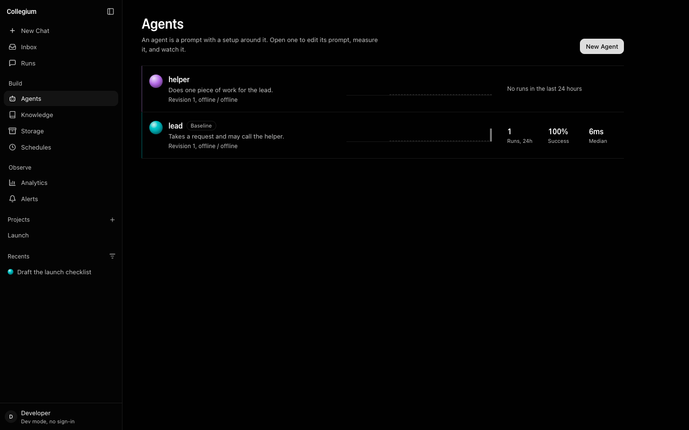
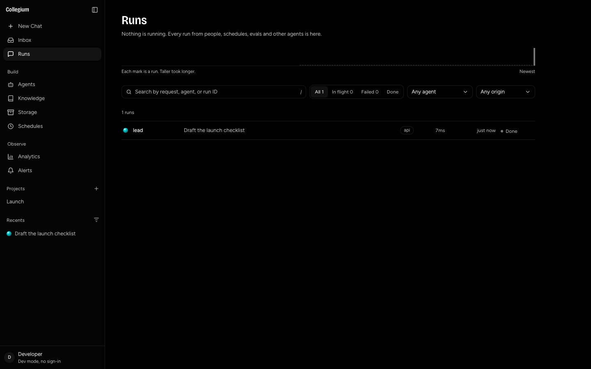
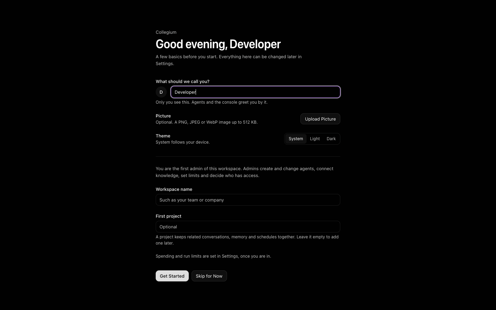
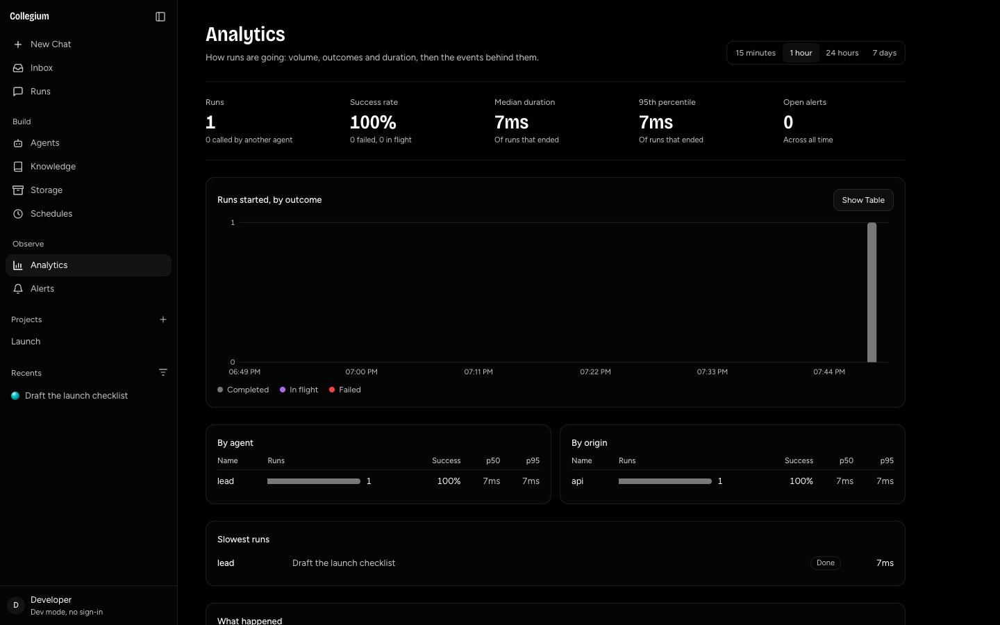

<p align="center">
  <h1 align="center">collegium</h1>
  <p align="center">
    A shared runtime and console for agents, conversations, governed calls and integrations.
    <br /><br />
    <a href="#installation">Install</a> &middot;
    <a href="https://github.com/urmzd/collegium/issues">Report Bug</a> &middot;
    <a href="docs/architecture.md">Architecture</a>
  </p>
</p>

<p align="center">
  <a href="https://github.com/urmzd/collegium/actions/workflows/ci.yml"></a>
  <a href="LICENSE"></a>
</p>

<p align="center">
  
</p>
<p align="center"><em>Local development preview with seeded example data, captured with teasr. No model calls.</em></p>

## Features

- Branch conversations across agents, with a shared call primitive for subagents, handoffs and delegations.
- Edit agents and revisions, run deterministic evals, schedule work and inspect run traces.
- Apply tenant permissions, depth and fan-out limits, run admission policies and usage accounting.
- Search knowledge, manage project memory and inspect alerts and analytics in the web console.
- Connect GitHub and Slack through signed webhook ingress and tenant-bound connector capabilities.
- Answer in Slack with the console's own components through a Socket Mode app that streams natively.

**Early development:** platform records are in memory. Spend limits are recorded but not enforced. General run approvals, local accounts and per-project access are unfinished. GitHub and Slack integrations have simulated-API coverage; see the [integration trial guide](docs/integrations.md) and [status table](docs/architecture.md#status) for validation boundaries.

## Installation

### Prerequisites

| Requirement | Purpose |
|-------------|---------|
| Go version from [`go.mod`](go.mod) | Build the server |
| Node.js 22.12+ or 24+, pnpm | Build the Vite console |
| Sibling `vultus` checkout | The console links its web packages, which are not published to npm |
| Chrome/Chromium and [teasr](https://github.com/urmzd/teasr) | Optional screenshot capture |

The Go modules are published and need no sibling checkout. The console does: keep `vultus` beside `collegium`.

```sh
git clone https://github.com/urmzd/vultus.git
git clone https://github.com/urmzd/collegium.git
cd collegium
go mod download
(cd packages/adapter && pnpm install)
(cd apps/web && pnpm install)
```

A workspace answers through one or more [clients](docs/clients.md): a Slack app
or a GitHub installation, each with its own identity, secrets, agents and limits.
See the [integration trial guide](docs/integrations.md).

## Quick Start


Run the backend in one terminal:

```sh
make dev
```

Run the console in another terminal, from the repository root:

```sh
make web
```

Open <http://127.0.0.1:5173>, complete the first-run workspace form and select an example agent. The backend listens on `127.0.0.1:8080`. Seeded agents use mandatum's offline provider, so the preview requires no model key.

Development auth grants admin access on loopback. For real sign-in, roles and machine tokens, follow [the security guide](docs/security.md). To use Anthropic, set `ANTHROPIC_API_KEY` before starting the server and configure an agent with provider `anthropic`.

### Capture the console

With a fresh `make dev` process and `make web` running:

```sh
teasr run
```

[`teasr.toml`](teasr.toml) captures onboarding, completes the setup form, then captures the console pages. After onboarding has already completed:

```sh
teasr run --scenes home,runs,agents,analytics,primitives
```

Images are written to [`showcase/`](showcase/). Restart the development backend to capture onboarding again.

<p align="center">
   &nbsp;
   &nbsp;
  
</p>
<p align="center"><em>Runs &middot; Workspace setup &middot; Analytics</em></p>

## Conversations

`POST /api/runs` takes `agent`, `text`, and optionally `after` and `project`.

- Leave `agent` empty or `auto` and the platform picks: the agent whose name,
  description or prompt best matches the message, or the workspace's baseline.
- `after` names the turn the message follows. Naming a turn that already has a
  reply starts a branch. Any agent can answer any turn, and is sent the branch
  so far.

## API

| Route | Permission |
|-------|------------|
| `GET /api/me` | Signed in |
| `GET`, `POST /api/agents`, `PUT /api/agents/{name}`, `GET /api/agents/{name}/history` | `agents:read`, `agents:write` |
| `GET`, `POST /api/runs`, `GET /api/runs/{id}`, `/tree`, `/trace` | `runs:read`, `runs:write` |
| `GET /api/threads`, `GET /api/threads/{id}` | `runs:read` |
| `GET /api/pick?q=`, `GET`, `PUT /api/settings` | `agents:read`, `agents:write` |
| `GET`, `POST /api/evals`, `PUT`, `DELETE /api/evals/{name}`, `POST .../run`, `GET .../runs` | `evals:read`, `evals:write` |
| `GET`, `PUT /api/preferences`, `GET`, `PUT`, `DELETE /api/preferences/photo` | Signed in, the caller's own |
| `POST /api/runs/{id}/calls` | `runs:write` |
| `GET /api/events?topic=agent[:name[:run]]` | `runs:read`, server-sent events |
| `GET /api/analytics?window=1h` | `runs:read` |
| `GET /api/journal?agent=&run=&kind=&origin=&q=&window=` | `runs:read` |
| `GET`, `POST /api/schedules`, `DELETE /api/schedules/{name}`, `POST .../pause`, `.../resume`, `.../run` | `schedules:read`, `schedules:write` |
| `GET /api/alerts`, `POST /api/alerts/{id}/ack`, `GET`, `POST`, `DELETE /api/alert-rules` | `alerts:read`, `alerts:write` |
| `GET`, `POST /api/knowledge`, `.../{name}/documents`, `GET /api/knowledge/search?q=` | `knowledge:read`, `knowledge:write` |

## Development

| Task | Command |
|------|---------|
| Set up hooks and modules | `make init` |
| Format, lint and test | `make check` |
| Test with race detection | `make test` |
| Web typecheck and tests | `cd apps/web && pnpm typecheck && pnpm test` |
| Shared adapter typecheck and tests | `cd packages/adapter && pnpm typecheck && pnpm test` |
| Slack app lint, typecheck and tests | `cd apps/slack && pnpm exec biome check && pnpm typecheck && pnpm test` |

## Architecture

Collegium composes [mandatum](https://github.com/urmzd/mandatum) for the bus and connectors, [saige](https://github.com/urmzd/saige) for agent execution and evals, [legatus](https://github.com/urmzd/legatus) for workspace isolation and [duraturo](https://github.com/urmzd/duraturo) for durability primitives. [vultus](https://github.com/urmzd/vultus) supplies web and Slack presentation.

An agent-to-agent call creates a run through `pkg/call`; its edge determines access, budget, depth and delegation mode. The platform owns identity, storage and orchestration; vultus owns rendering. Read the [architecture and implementation status](docs/architecture.md) before relying on planned persistence or governance features.

## License

[Apache-2.0](LICENSE)
